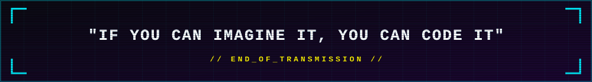

  

 

  

 

<em>Passionate about software development and game engines. Specializing in low-level and high-level programming
with hands-on experience in application development, graphics APIs, and build systems.</em>

 

  

 

**`> LANGUAGES`**

**`> GRAPHICS APIs`**

**`> BUILD SYSTEMS & TOOLS`**

**`> IDEs & ENGINES`**

 

  

 

  

 

  

